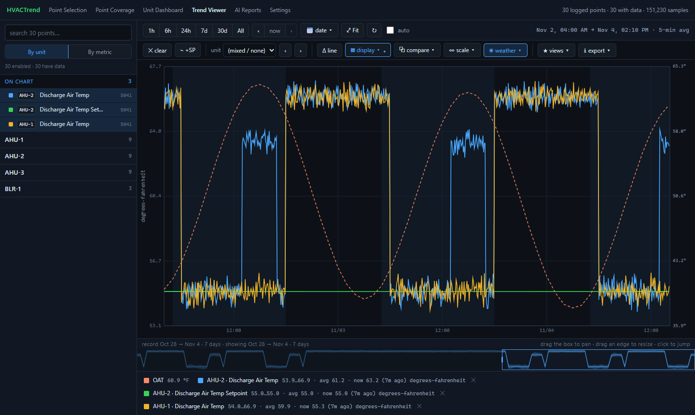
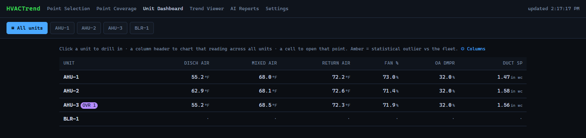
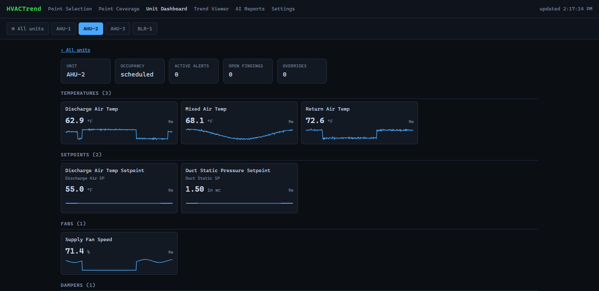

# HVACTrend

[](https://github.com/jamesccupps/HVACTrend/releases/latest)
[](https://github.com/jamesccupps/HVACTrend/actions/workflows/ci.yml)
[](LICENSE)
[](https://www.python.org/downloads/)

**A read-only BACnet/IP trend logger, web viewer and alarm system for building HVAC.**

HVACTrend sits on your building's BACnet network and records the points you choose every two
minutes: temperatures, setpoints, fan speeds, valves, dampers, statuses. It keeps that history
for as long as you like, and shows it in a fast trend viewer you open in a browser. It watches
for equipment that is not doing what it is told (discharge air off setpoint, duct static low, a
boiler enabled but not heating, a controller's own alarms) and sends those to your phone. And it
never writes to a controller: it cannot change anything in your building.

**[⬇ Download the latest release](https://github.com/jamesccupps/HVACTrend/releases/latest)**
(Windows or Linux, Python 3.11+) · [Try the demo](#try-it-in-a-minute-without-a-bacnet-network) ·
[Getting started](docs/getting-started.md) · [All releases](https://github.com/jamesccupps/HVACTrend/releases)



<sub>The demo building (`scripts/demo.py`): made-up data.</sub>

It was built for a real building, an office tower with Trane, Siemens and JCI controls, and runs
there around the clock. It is written to work in any building with BACnet/IP.

## What it does

- **Trend logging.** Polls the points you pick with ReadPropertyMultiple, falling back to
  single reads for controllers that need it. Each reading carries its quality: good, faulted
  or no response. Stores everything in SQLite, with 5-minute and hourly averages so a year
  of data charts instantly.
- **A trend viewer made for HVAC work.**
  - Zoom and pan; jump to a day; compare against the previous day or week.
  - Plot a reading against its setpoint as an error line, or against the rest of the units.
  - X-Y scatter, outdoor weather overlay, occupied-hours shading.
  - Operator notes on the timeline, saved views, and export to CSV.
  - Works on a phone.
- **Realtime trends, for testing and diagnosing.** Pick points and read them every 5 seconds
  (or 10, 15, 30, 60) for as long as you choose, each point for its own time if you like:
  watch a valve while it is stroked, or a discharge temperature settle after a change.
  - Live charts grouped by unit, with a readout of every value under the pointer or a finger.
  - Stop one point or all of them. Caps on how many run at once protect the controllers.
  - The readings are kept, apart from the 2-minute record. Past sessions open as charts and
    export to CSV.
  - Built for a phone, and open to the other computers you let in.
- **A unit dashboard.** Every air handler and plant system on one screen, with the readings
  that matter, outliers highlighted, and who has overridden what.
- **Overrides, seen.** It reads (never writes) each commandable point's priority array, so you
  can see when someone at the workstation is holding a setpoint by hand, and since when.
- **Rule-based alarms on your phone.** A separate watchdog checks every 5 minutes.
  - It tells you when data stops, when a controller stops answering, and when equipment alarms
    open, get worse or clear.
  - Every morning it sends a check-in, and once a day a reminder of what is still wrong.
  - Notifications go through [ntfy](https://ntfy.sh): free, no account.
- **Point coverage.** It shows which alarm rules each unit can be judged by, and which points
  you would need to log for the rest.
- **Rescan a controller after a programming change.** One button on Point Selection: new
  points appear on their unit's list, renamed ones keep their history, and logging carries on
  while it reads.
- **Backups.** A verified copy of the database every week, optionally to a synced folder off
  the computer, and a daily copy of your configuration.
- **An AI summary, if you want one.** A daily and weekly plain-language summary of what the
  alarm rules found, written by Claude. It explains the alarms; it does not invent new ones.
  Off by default, and it needs your own API key.

| The unit dashboard | One unit |
|---|---|
|  |  |

## Safe by design

- **Read-only BACnet.**
  - The program only sends reads and discovery.
  - Writes are refused in code, whatever the configuration says.
  - Disruptive services (reinitialize, communication control, file writes, create or delete
    object) are blocked outright.
  - None of this can be switched on from the web pages.
- **The web pages are local by default.**
  - Out of the box only the computer it runs on can open them.
  - When you let others in, they get the trend viewer and the Realtime page, and nothing
    else: no settings, no secrets, no backups.
- **Secrets stay out of files you share.** API keys and the notification topic are entered
  on the Settings page and kept in a separate file that is never committed or backed up.

[docs/security.md](docs/security.md) has the details.

## Try it in a minute, without a BACnet network

```bash
git clone https://github.com/jamesccupps/HVACTrend.git
cd HVACTrend
python -m venv .venv
.venv/bin/pip install -e .          # Windows: .venv\Scripts\pip install -e .
.venv/bin/python scripts/demo.py    # Windows: .venv\Scripts\python scripts\demo.py
```

Open <http://localhost:8001>. It's a made-up building with a week of readings, one unit that
runs warm in the afternoons, and an operator override. The demo prints what the alarm rules
found (a real system sends those to your phone). Nothing is sent anywhere.

## Install it for your building

**Windows** (the tested platform): install Python 3.11+ from
[python.org](https://www.python.org/downloads/) and download or clone this repository. Then:

1. Double-click `install.bat`. It creates a private Python environment, installs HVACTrend
   and runs the setup wizard. The wizard asks for the building name, which network card is
   on the BACnet network, and who may open the pages.
2. Find your controllers: `.venv\Scripts\python scripts\discover.py --identify`.
3. Tell HVACTrend which controller runs which unit (the `equipment` section of
   `config\config.yaml`), then run `.venv\Scripts\python scripts\commission.py`.
4. Double-click `start.bat` and choose what to log on the **Point Selection** page.
5. Run `scripts\windows\install-service.ps1` as administrator to keep it running from boot,
   watchdog included.

**Linux / macOS**: `./install.sh`, then the same steps with `./start.sh`. systemd unit files
are in [deploy/systemd](deploy/systemd).

The full walkthrough is [docs/getting-started.md](docs/getting-started.md).

## Documentation

| | |
|---|---|
| [Getting started](docs/getting-started.md) | From download to logging, step by step |
| [Installation](docs/install.md) | Windows, Linux, running as a service, upgrading, troubleshooting |
| [Commissioning](docs/commissioning.md) | Discovery, the equipment map, choosing points, site knowledge |
| [Alarms and notifications](docs/alerts.md) | The rules, phone notifications, tuning thresholds |
| [Configuration](docs/configuration.md) | Every setting in `config.yaml` |
| [Security](docs/security.md) | The read-only guarantee, network access, secrets |
| [How it works](docs/architecture.md) | Processes, storage, the code layout |

## Requirements

- **A computer on the building's BACnet/IP network.** A small always-on PC is ideal. It
  records only while it is running.
- **Python 3.11 or newer.**
- **Controllers reachable over BACnet/IP.** MS/TP controllers behind a BACnet router are fine.
- **Disk:** about 35 MB a day per 1,000 logged points, at the default 2-minute interval.

## Status

Version 0.2. HVACTrend has run in production in one building since July 2026. The core is
covered by more than 450 automated tests, with no hardware needed:
- logging, storage and backups;
- the viewer;
- the alarm rules and notifications.

Other buildings will name their points differently. If yours are not recognised (the
dashboard and the alarm rules rely on it), please open an issue with a few example point names.

## License

[MIT](LICENSE). Not affiliated with or endorsed by ASHRAE or any controls manufacturer.
